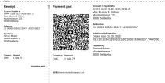
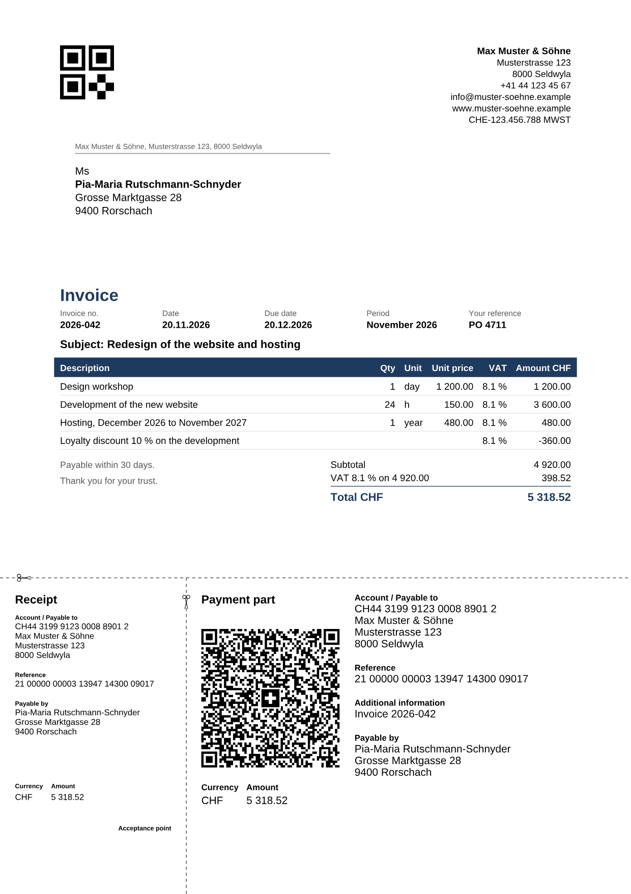
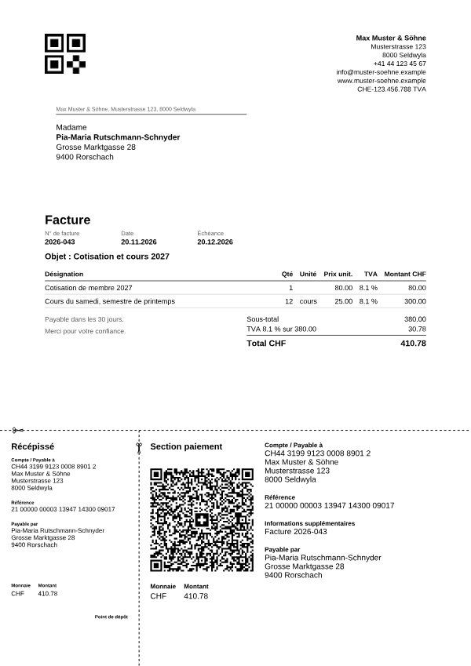
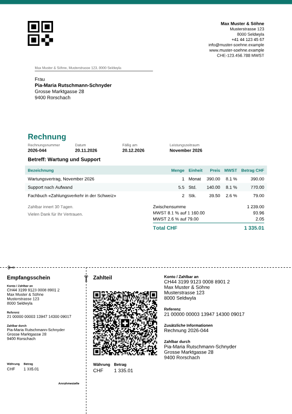

<h1 align="center">
  <picture>
    <source media="(prefers-color-scheme: dark)" srcset="https://raw.githubusercontent.com/qr-bill/qr-bill/main/docs/assets/logo-white.svg" />
    <source media="(prefers-color-scheme: light)" srcset="https://raw.githubusercontent.com/qr-bill/qr-bill/main/docs/assets/logo-black.svg" />
    
  </picture>
</h1>

<p align="center">
  <a href="https://github.com/qr-bill/qr-bill/actions/workflows/ci.yml"></a>
  <a href="https://www.npmjs.com/package/@qr-bill/core"></a>
  <a href="https://bundlejs.com/?q=@qr-bill/core"></a>
  <a href="vitest.config.ts"></a>
  <a href="packages/core/package.json"></a>
  <a href="LICENSE"></a>
</p>

Swiss QR-bill (QR-Rechnung, QR-facture, QR-fattura, Quint QR) for JavaScript and TypeScript, following the [SIX Implementation Guidelines v2.4](https://www.six-group.com/en/products-services/banking-services/payment-standardization/standards/qr-bill.html), in force since 14 November 2026.

<p align="center">
  
</p>

- **Runs everywhere.** No Node or DOM API in the core: browsers, Node, Deno, Bun, Cloudflare Workers, React Native.
- **Zero dependencies** in the core. PDF engines live in separate adapters. An application only carries what it imports: `isValidIBAN` alone is 340 bytes once bundled.
- **Up to date with v2.4.** Structured addresses only, QR-IBAN and QR reference reserved for CHF, extended character set, Romansh.
- **No floating-point money.** Amounts are decimal strings; `fromCents()` converts what you store.
- **The official rules for your forms.** One validator per field (`validateName`, `validateAccount`, `validateAmount`…), the very ones the library uses, so a form that passes them makes a valid QR-bill.
- **Every problem at once.** Validation reports all issues with stable codes, and plugs into any [Standard Schema](https://standardschema.dev) consumer (Hono, tRPC, TanStack Form…).
- **Reads QR-bills too.** `parseQRBill()` turns a scanned Swiss QR Code back into a validated bill.

## Documentation

- [Getting started](#example): a QR-bill, its Swiss QR Code and its payment slip as SVG.
- [Validate a form, field by field](#validate-a-form-field-by-field), with the rules of the standard.
- [The payment slip in a PDF](docs/pdfkit.md), with PDFKit: `@qr-bill/pdfkit`.
- [Invoices](docs/invoice.md): an A4 invoice with its QR-bill, from your data: `@qr-bill/invoice`, in this repository, on npm from its next release.
- The API reference: every export is documented in the code with an example, and `pnpm docs:build` generates the reference in `docs/api/`.
- [Architecture](docs/architecture.md), the design and its decisions; [releasing](docs/releasing.md), how a version gets to npm; [contributing](CONTRIBUTING.md).

The standard itself is published by SIX: the [Implementation Guidelines and the style guide of the QR-bill](https://www.six-group.com/en/products-services/banking-services/payment-standardization/standards/qr-bill.html), and the [validation portal](https://validation.iso-payments.ch/gp/qrrechnung) for Swiss QR Codes (free registration).

## Example

```ts
import { createQRBill, createQRReference, fromCents, layoutQRBill, renderSVG } from '@qr-bill/core';

const bill = createQRBill({
  currency: 'CHF',
  amount: fromCents(194975), // "1949.75"
  creditor: {
    account: 'CH44 3199 9123 0008 8901 2', // QR-IBAN
    name: 'Max Muster & Söhne',
    street: 'Musterstrasse',
    buildingNumber: '123',
    postalCode: '8000',
    town: 'Seldwyla',
    country: 'CH',
  },
  reference: createQRReference('21000000000313947143000901'),
  message: 'Order from 15.10.2020',
});

bill.payload; // content of the Swiss QR Code

const layout = layoutQRBill(bill, { language: 'fr' }); // receipt and payment part, positioned in millimetres
const svg = renderSVG(layout); // SVG document of 210 × 105 mm, Swiss QR Code and cutting lines included
```

Invalid input throws a `QRBillValidationError` whose `issues` list every problem:

```ts
import { validateQRBill } from '@qr-bill/core';

const result = validateQRBill(requestBody); // never throws, accepts unknown
if (!result.success) {
  result.issues; // [{ code: 'qr_iban_requires_chf', path: ['currency'], message: '…' }, …]
}
```

## PDF

[`@qr-bill/pdfkit`](packages/pdfkit) adds the payment slip to a [PDFKit](https://pdfkit.org) document, with its fonts:

```ts
import { attachTo } from '@qr-bill/pdfkit';

attachTo(doc, bill, { language: 'fr' }); // at the bottom of the last page, or on a new page if the invoice leaves no room
```

Options, fonts and how to write your own invoice above the slip: [docs/pdfkit.md](docs/pdfkit.md).

## Invoices

[`@qr-bill/invoice`](docs/invoice.md) writes a complete A4 invoice from your data: your logo and details, the address window, the lines with their VAT, the totals, ready-made mentions, and the payment slip at the bottom of the last page. In five languages and three themes. It is in this repository, and on npm from its next release.

<p align="center">
  <a href="docs/assets/invoice-business.pdf"></a>
</p>
<p align="center">
  <a href="docs/assets/invoice-standard.pdf"></a>
  <a href="docs/assets/invoice-modern.pdf"></a>
</p>
<p align="center">The themes <code>business</code>, <code>standard</code> and <code>modern</code>: each invoice opens as a PDF.</p>

```ts
import { createInvoicePDF } from '@qr-bill/invoice';

const pdf = await createInvoicePDF({
  language: 'en',
  theme: 'business',
  date: '2026-11-20',
  issuer: {
    name: 'Max Muster & Söhne',
    street: 'Musterstrasse',
    buildingNumber: '123',
    postalCode: '8000',
    town: 'Seldwyla',
    country: 'CH',
  },
  recipient: {
    name: 'Pia-Maria Rutschmann-Schnyder',
    street: 'Grosse Marktgasse',
    buildingNumber: '28',
    postalCode: '9400',
    town: 'Rorschach',
    country: 'CH',
  },
  items: [{ description: 'Development of the new website', quantity: 24, unit: 'h', unitPrice: '150', vatRate: '8.1' }],
  payment: { account: 'CH44 3199 9123 0008 8901 2', reference: '210000000003139471430009017' },
}); // the bytes of the PDF
```

## Validate a form, field by field

Each field of the QR-bill has its validator. It takes the value as typed and returns `true`/`false` when there are two outcomes, or a status naming the problem, ready to be translated:

```ts
import {
  validateAccount,
  validateCountry,
  validateName,
  validateReference,
  validateReferenceForAccount,
} from '@qr-bill/core';

validateName('  '); // 'required'
validateCountry('CHE'); // 'invalid_country': two letters expected
validateAccount('CH44 3199 9123 0008 8901 2'); // 'qr_iban'
validateReference('RF18 5390 0754 7034'); // 'SCOR'

// Rules on several fields, once each field is valid
validateReferenceForAccount('qr_iban', 'SCOR'); // 'qr_iban_requires_qr_reference'
```

The maximum lengths are exported too (`ADDRESS_MAX_LENGTH.name` is 70), for the `maxlength` of your inputs.

## Packages

| Package                                | Version                                                                                               | Documentation                      | Purpose                                               |
| -------------------------------------- | ----------------------------------------------------------------------------------------------------- | ---------------------------------- | ----------------------------------------------------- |
| [`@qr-bill/core`](packages/core)       | [](https://www.npmjs.com/package/@qr-bill/core)     | [Getting started](#example)        | Validation, payload, references, parsing, layout, SVG |
| [`@qr-bill/pdfkit`](packages/pdfkit)   | [](https://www.npmjs.com/package/@qr-bill/pdfkit) | [docs/pdfkit.md](docs/pdfkit.md)   | Payment slip in a PDFKit document (Node)              |
| [`@qr-bill/invoice`](packages/invoice) | next release                                                                                          | [docs/invoice.md](docs/invoice.md) | A4 invoice with its QR-bill, from data, as a PDF      |
| `@qr-bill/jspdf`                       | planned                                                                                               | —                                  | Payment slip in a jsPDF document (browser)            |

## Quality

- The six examples of the standard are conformance tests ([`conformance/`](conformance)), shared with future implementations in other languages. While writing them we found that example 4 of the standard prints a Creditor Reference with wrong check digits; the file documents it.
- Property-based tests (fast-check) for check digits, amounts, character set and round trips.
- Every example of the documentation comments is run by the tests, so the documentation cannot drift from the code.
- 100 % coverage enforced in CI on Node 22, 24 and 26.

See [docs/architecture.md](docs/architecture.md) for the design.

## Contributing

Issues and pull requests are welcome. The workflow, the code conventions and how to add a rule of the standard are described in [CONTRIBUTING.md](CONTRIBUTING.md).

## Acknowledgements

The QR code encoder is adapted from the [QR Code generator library](https://www.nayuki.io/page/qr-code-generator-library) of Project Nayuki (MIT); its notice is in [LICENSE](packages/core/LICENSE).

The text is measured with, and the PDF adapter embeds, the [Liberation Sans](https://github.com/liberationfonts/liberation-fonts) fonts (SIL Open Font License 1.1), shipped unmodified in [`packages/pdfkit/fonts`](packages/pdfkit/fonts).

## Trademarks

qr-bill is an independent open-source project. It is not affiliated with or endorsed by SIX Group, whose subsidiary SIX Interbank Clearing Ltd publishes the Swiss Implementation Guidelines for the QR-bill. "QR Code" is a registered trademark of DENSO WAVE INCORPORATED.

## License

MIT © Olivier Azevedo — maintained by [Claine](https://claine.ai).
