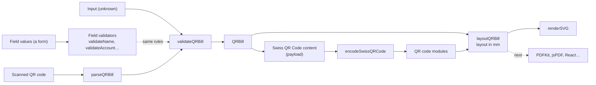

# Architecture

## Goals

1. **Conform to the SIX Implementation Guidelines for the QR-bill, v2.4** (24.02.2026, in force since 14.11.2026). v2.4 is stricter than v2.3 (still accepted until November 2027), so a v2.4 bill is valid for both: there is no version option.
2. **Run in every JavaScript runtime** without polyfills or bundler configuration: browsers (Vite, webpack…), Node, Deno, Bun, Cloudflare Workers, React Native.
3. **Stay small**: zero dependencies in the core, PDF engines as optional adapters, and an application only carries the functions it imports.
4. **Be trustworthy for money**: no floating-point amounts, every rule of the standard tested, reproducible builds, provenance on every release.
5. **Be readable**: one folder per concept of the standard, every exported function documented with its parameters, result and an example that the tests run.

Non-goals: generating whole invoices (the caller owns the invoice layout; we add the payment part to it), eBill.

## Pipeline

- **Field validators** (`validateName`, `validateAccount`, `validateAmount`…) check one field as typed in a form and return a boolean or a status (`'valid'`, `'required'`, `'too_long'`…). Rules that involve several fields have their own validators (`validateReferenceForAccount`, `isZeroAmountAllowed`…).
- **Validation of the bill** (`validateQRBill`) applies those same validators to every field, then the rules on several fields, then the size of the Swiss QR Code. It accepts `unknown`, reports every issue with a stable code and a path, and never throws. `createQRBill` is the throwing variant; `qrBillSchema` exposes it as a Standard Schema.
- **QRBill** is immutable and normalized (IBAN without spaces, NFC text, country in upper case, amount with two decimals).
- **Payload** follows table 8 of the standard: 31 mandatory lines, optional trailing elements left out when unused, no line break after the last element. `parseQRBill` reverses it through the same validation.
- **QR code** (`encodeSwissQRCode`) encodes the payload as chapter 6 requires: byte mode in UTF-8, error correction level M, the smallest version that holds it (at most 25), the mask with the lowest penalty. It returns the modules as plain data; the quiet zone, the size of 46 × 46 mm and the Swiss cross belong to the layout.
- **Layout** (`layoutQRBill`) places every element of the receipt and the payment part in millimetres, as data: lines of text at their baseline, and paths (the QR code as one path, the Swiss cross, corner marks, cutting lines, scissors). Renderers only draw texts and paths, so the conformity of the layout to the style guide is tested once, on the layout, not once per renderer. `renderSVG` is the reference renderer; PDF adapters come next.

## Source layout

`packages/core/src` has one folder per concept of the standard. Inside a folder, the file name says what a file holds:

| Suffix           | Holds                                                                               |
| ---------------- | ----------------------------------------------------------------------------------- |
| `*.types.ts`     | Types only: the shapes of the data and the statuses returned by the validators.     |
| `*.validator.ts` | Validators: pure functions that never throw and return a boolean or a status.       |
| other `*.ts`     | Everything else: normalizing, formatting, building references, writing the payload. |

| Folder                    | Concept                                                                                                                   | Chapters of the IG  |
| ------------------------- | ------------------------------------------------------------------------------------------------------------------------- | ------------------- |
| `account/`                | Creditor account: IBAN and QR-IBAN                                                                                        | 2.7–2.10            |
| `address/`                | Creditor and debtor addresses, country codes                                                                              | 4.2.2               |
| `amount/`                 | Amount and currency                                                                                                       | 3.5.3, 4.2.2, 4.4   |
| `reference/`              | QR reference and Creditor Reference                                                                                       | 2.12, 4.3.2, B      |
| `additional-information/` | Message, billing information, alternative procedures                                                                      | 4.2.2, 4.3.3        |
| `text/`                   | Character set, normalization, UTF-8, validation of free text                                                              | 4.1.1               |
| `checksum/`               | Check digit algorithms: modulo 10 recursive, ISO 7064 MOD 97-10                                                           | Annex B             |
| `qr-code/`                | The Swiss QR Code: capacity, Reed-Solomon, codewords, modules and masks, encoder (adapted from Project Nayuki)            | 6, ISO/IEC 18004    |
| `layout/`                 | The payment slip: dimensions of the style guide, text measured with Liberation Sans, receipt, payment part, cutting lines | 3, 6.4, style guide |
| `svg/`                    | Rendering of a layout as SVG                                                                                              | —                   |
| `labels/`                 | Texts printed on the payment part and the receipt, in five languages                                                      | Annex C             |
| `bill/`                   | The bill as a whole: validation, rules on several fields, payload, parsing                                                | 4, 7.1              |

`index.ts` only re-exports the public API. Tests mirror the folders in `packages/core/test`.

## Packages

| Package           | Depends on      | Notes                                                               |
| ----------------- | --------------- | ------------------------------------------------------------------- |
| `@qr-bill/core`   | nothing         | `.` today; `/svg` and `/layout` subpaths next                       |
| `@qr-bill/pdfkit` | `pdfkit` (peer) | server-side PDF, first adapter                                      |
| `@qr-bill/jspdf`  | `jspdf` (peer)  | browser-side PDF                                                    |
| `@qr-bill/react`  | `react` (peer)  | later; React Native through `react-native-svg`                      |
| `@qr-bill/camt`   | —               | later: reconcile ISO 20022 camt.054 bank statements by QR reference |

## Decisions

| Decision                                                                                         | Why                                                                                                                                                                                                                                                                                                                                                                                                                    |
| ------------------------------------------------------------------------------------------------ | ---------------------------------------------------------------------------------------------------------------------------------------------------------------------------------------------------------------------------------------------------------------------------------------------------------------------------------------------------------------------------------------------------------------------- |
| One validator per field, and `validateQRBill` built on them                                      | A form validated field by field with the public validators is guaranteed to be accepted by `createQRBill`: there is a single implementation of each rule.                                                                                                                                                                                                                                                              |
| A validator returns a boolean (two states) or a status (more)                                    | A status names the problem (`'too_long'`, `'invalid_characters'`…) with the same values as the issue codes, so an application can translate it. When a field has several problems, the first in a fixed order is returned (`required`, then `invalid_characters`, then `too_long`); `validateQRBill` reports one issue per field.                                                                                      |
| Blank counts as missing                                                                          | A field made of spaces is reported as `required` when mandatory and ignored when optional, the same way for every field, the account and the alternative procedures included.                                                                                                                                                                                                                                          |
| Country checked before upper-casing                                                              | Upper-casing can change the length and the letters: "ß" becomes "SS" (South Sudan), "ʼn" becomes "ʼN", whose "ʼ" is outside the character set.                                                                                                                                                                                                                                                                          |
| Core compiled with `"types": []` and an ES-only `lib`                                            | Any use of `Buffer`, `document`, `TextEncoder`… is a compile error, which guarantees portability. UTF-8 encoding is hand-written for that reason.                                                                                                                                                                                                                                                                      |
| Amounts as decimal strings, `fromCents()` helper                                                 | Floats cannot represent most cents exactly. Numbers are accepted only when they carry at most two decimals exactly (`0.1 + 0.2` is rejected).                                                                                                                                                                                                                                                                          |
| Characters counted as Unicode code points                                                        | That is what the standard limits. Input is NFC-normalized first, so a decomposed "é" (macOS input) is accepted.                                                                                                                                                                                                                                                                                                        |
| `0.00` only with a "DO NOT USE FOR PAYMENT" message                                              | Chapter 4.4: zero is reserved for notifications.                                                                                                                                                                                                                                                                                                                                                                       |
| QR-IBAN requires CHF                                                                             | New in v2.4 after the end of euroSIC.                                                                                                                                                                                                                                                                                                                                                                                  |
| Payload limited to 997 **bytes**                                                                 | 997 is the byte capacity of QR version 25 at level M, the maximum allowed. Counting bytes rather than characters guarantees it with multi-byte characters.                                                                                                                                                                                                                                                             |
| Data built lazily (country codes)                                                                | A module-level `new Set(…)` cannot be removed by a bundler, so an application that only checks an IBAN would carry the 250 country codes. A test bundles the public API to keep it that way.                                                                                                                                                                                                                           |
| Text measured with Liberation Sans, whose widths are in the core                                 | One of the four fonts the QR-bill allows (chapter 3.4), free (SIL OFL), metric-compatible with Arial, and it covers Latin Extended-A, which the standard PDF Helvetica cannot render. A layout measured once, without canvas or font file, breaks lines the same in every runtime; PDF adapters embed the same font so that the widths match. `scripts/generate-font-metrics.py` writes the table from the font files. |
| Long information: smaller fonts, then shortening                                                 | The payment part tries 8/10 pt (recommended), 7/9 pt, then 6/8 pt (the minimum, chapter 3.4); only then the additional information is shortened with an ellipsis (3.5.4). Address lines take at most two lines each. The receipt leaves the streets out when they do not fit (3.6.2). A property test lays out bills at the maximum lengths and checks that no text leaves its section.                                |
| Cutting lines with scissors by default                                                           | Most slips are now sent as PDF, which chapter 3.7 requires to mark the cutting lines; the instruction "Separate before paying in" or no line at all (perforated paper) are options.                                                                                                                                                                                                                                    |
| Swiss cross drawn from the description of the standard                                           | A white cross with the proportions of the Swiss coat of arms on a black square with a white border, 7 × 7 mm (chapter 6.4.2); no file to embed. The end-to-end test reads the QR code back with the cross over it.                                                                                                                                                                                                     |
| ESM only, Node ≥ 22.12                                                                           | `require(esm)` works natively from Node 22.12, so CommonJS consumers are still served.                                                                                                                                                                                                                                                                                                                                 |
| Shared conformance vectors in JSON                                                               | A future Rust crate reuses them as is, instead of sharing code through WASM (weight, async init, React Native).                                                                                                                                                                                                                                                                                                        |
| QR encoder adapted from Project Nayuki (MIT), reduced to byte mode, level M and versions 1 to 25 | A careful, widely reused implementation of ISO/IEC 18004 (swissqrbill and qrcode.react use it too), taken from its source, not from another QR-bill library. Writing an encoder from the paid ISO standard would take weeks and risk subtle bugs. Every derived file keeps the MIT notice, and `packages/core/LICENSE` carries it in the published package, whose build removes comments.                              |

## Documentation

- Every exported declaration has a documentation comment: what it does, its parameters, its result, the chapter of the standard, and for most functions an example. Every file starts with a comment that says what it holds.
- `pnpm docs:build` generates the API reference with [TypeDoc](https://typedoc.org) in `docs/api/` (not versioned), one page per source file. `pnpm docs:watch` rebuilds it on every change. The CI fails when a declaration is not documented or a link is broken.
- `scripts/typedoc-link-by-name.js` lets `{@link name}` point to a declaration of another file, so comments stay short: `{@link validateQRBill}` rather than a path.

## Known traps (next steps)

- **Fonts in PDF.** The standard PDF Helvetica (WinAnsi) cannot render Latin Extended-A (ł, ő, Ș…), which v2.3+ allows. PDF adapters embed Liberation Sans, the font the layout is measured with.
- **Space for the payment part.** `attachTo` must check that 105 mm are free at the bottom of the last page and add a page otherwise.

## Quality gates

- Conformance: the six examples of Annex A, payload line by line, in LF and CR LF.
- Property-based tests: check digits detect every single-digit error, amounts round-trip through cents, sanitized text is always valid, any generated bill parses back to itself.
- Documentation examples: every one-line example of the documentation comments (`validateCountry('ß'); // 'invalid_country'`) is run by the tests.
- Public API: a test lists every export, so adding or removing one is a visible decision.
- Layout: the dimensions of the style guide are tested one by one; no text leaves its section, for the six examples in the five languages and for random bills at the maximum lengths; the SVG of every example is rasterised (resvg) and its QR code, Swiss cross included, read back by ZXing.
- QR codes: every generated QR code is read back by a real decoder (ZXing, through `zxing-wasm`), and compared module by module with the original encoder of Project Nayuki, kept unmodified in `test/qr-code/reference/` as a witness: the reduction changes nothing, the choice of the mask included.
- Tree shaking: a test bundles a single import (`isValidIBAN`) and checks that the rest of the library is left out.
- 100 % coverage enforced; lint with `typescript-eslint` `strictTypeChecked`; formatting with Prettier.
- `publint` and `arethetypeswrong` on every build.
- Dependencies younger than 7 days are never installed (`minimumReleaseAge`).
- Releases through npm Trusted Publishing (OIDC) with provenance; no long-lived token.
- Publication blocked while a README carries a `<!-- release-blocker -->` comment or says "not published yet" (`scripts/check-release-blockers.js`, run as `prepublishOnly`).
