# Releasing

How the packages of qr-bill get from `main` to npm. Contributors only need the section on changesets: they add changesets, and the maintainers publish.

## In short

- Every pull request that changes a published package brings a **changeset**: a short file that says which package changes, how (patch, minor, major) and what users should know. Merging it publishes nothing; changesets pile up on `main`.
- When a maintainer decides to publish, they open a **release pull request**: `pnpm changeset version` turns the pending changesets into new versions and changelog entries.
- Merging the release pull request **stages** the new versions on npm. The **release workflow** runs on every push to `main` and compares the version of each package with npm: a version that is not on npm yet is staged, and its GitHub release is prepared as a draft. On any other push it finds nothing to do.
- A staged version is not public: a maintainer **approves** it on npmjs.com with two-factor authentication. The workflow waits for it, then publishes the GitHub release, which creates the tag.

```mermaid
flowchart LR
  feature["Pull request<br/>code + changeset"] -->|merge| main["main<br/>changesets pile up"]
  main -->|when the maintainer decides| release["Release pull request<br/>pnpm changeset version"]
  release -->|merge| workflow["Release workflow<br/>all the checks"]
  workflow --> staged["npm stage publish<br/>draft GitHub release"]
  staged -->|maintainer approves on npmjs.com, 2FA| npm["Public on npm<br/>provenance"]
  npm --> github["GitHub release published<br/>tag name@version"]
```



Publishing takes two human decisions: merging the release pull request on GitHub, and approving the staged versions on npm with two-factor authentication. Nothing is published from a computer, and no npm token exists anywhere: even a compromised GitHub account or workflow could not make a version public.

## Vocabulary

| Term               | Meaning here                                                                                                                                                                                                                                                                                                              |
| ------------------ | ------------------------------------------------------------------------------------------------------------------------------------------------------------------------------------------------------------------------------------------------------------------------------------------------------------------------- |
| Version            | The `version` of a package in its `package.json`, following [semantic versioning](https://semver.org); the rules are in [CONTRIBUTING.md](../CONTRIBUTING.md#versions). Each package has its own. A version published on npm can never be published again, even after it is removed: a mistake is fixed by a new version. |
| Changeset          | A Markdown file in `.changeset/`, written by `pnpm changeset`, consumed by `pnpm changeset version`.                                                                                                                                                                                                                      |
| Changelog          | `packages/<name>/CHANGELOG.md`, written by `pnpm changeset version` from the changesets.                                                                                                                                                                                                                                  |
| Staged version     | A version uploaded to npm with `npm stage publish` but not public yet. It waits in the "Staged Packages" tab of the package on npmjs.com until a maintainer approves or rejects it.                                                                                                                                       |
| npm dist-tag       | A label on a version on npm. `latest` is what `npm install @qr-bill/core` installs; prereleases go to `next`.                                                                                                                                                                                                             |
| Git tag            | `@qr-bill/<name>@<version>`, on the commit that was published: the code of a version, forever.                                                                                                                                                                                                                            |
| GitHub release     | The page of a tag on GitHub, with the changelog of the version. The workflow creates it as a draft when it stages the version, and publishes it once the version is approved, which creates the tag. The release of `@qr-bill/core` is marked as the latest of the repository.                                            |
| Trusted Publishing | npm accepts a staged version only from this repository's release workflow, which proves who it is with a short-lived OpenID Connect token from GitHub. There is no npm token to steal.                                                                                                                                    |
| Provenance         | A signed statement, shown on the npm page, that a version was built by this workflow from this commit. Anyone can check that the package matches the public code.                                                                                                                                                         |

## Changesets, in every pull request

Run `pnpm changeset` when a change affects a published package: its behaviour, its API, its types, or the documentation shipped in it (README, documentation comments). Choose the packages, the kind of version, and write one or two sentences for the users of the package, not for its maintainers. Commit the file with the change. For example `.changeset/brave-owls-sing.md`:

```md
---
'@qr-bill/core': patch
---

`validateTown` accepts a town of exactly 35 characters, as chapter 4.2.2 allows.
```

A change of the tests, the tooling or the documentation of the repository only needs no changeset. **Never change a `version` or a `CHANGELOG.md` in a feature pull request**: only a release pull request does.

`pnpm changeset status` lists the changesets waiting on `main` and the versions they will produce.

## Publishing, step by step

1. **Decide.** On an up-to-date `main`, `pnpm changeset status` shows what is pending. Publish when a fix is waiting, or when enough has piled up; there is no fixed rhythm. Plan to be available for half an hour after the merge, to approve on npm.
2. **Issue and branch.** Open an issue `chore: release`, then a branch `chore/release-<date or versions>` from `main`.
3. **Version.** Run `pnpm changeset version`. It raises the versions in the `package.json` files (a package that depends on a changed one is raised too when needed), writes the changelogs and deletes the consumed changesets. Read the diff: the versions are the expected ones, and every changelog entry makes sense to a user. The wording of the changelogs may be improved by hand in this pull request.
4. **Check.** `pnpm release:plan` lists the packages to stage. Run the usual checks.
5. **Pull request.** Commit as `chore: release <versions> (#<issue>)`, open the pull request, let the CI pass, merge it ("Squash and merge").
6. **Watch.** In the Actions tab, the "Release" workflow runs on the merge commit: "Plan", then "Publish", which runs every check again, stages each new version on npm and creates its draft release. It then waits up to 30 minutes for the approval.
7. **Approve.** On npmjs.com, open the "Staged Packages" tab of each package (or `npm stage list` in a terminal), check the version and its files, and approve it with two-factor authentication. Several packages can be approved in one action.
8. **Verify.** Within a minute, the workflow sees the approved versions, publishes their GitHub releases and ends. `npm view @qr-bill/<name> version` shows the new version, the npm page shows the provenance badge, and the tags and releases are on GitHub.

If the approval comes after the 30 minutes, nothing is lost: the GitHub releases are published by the next run of the workflow, at the next push to `main` or with "Run workflow" (with "dry-run" unticked).

### Prereleases

To let users try a version before it becomes `latest`, enter the prerelease mode on a release branch with `pnpm changeset pre enter next`, then `pnpm changeset version`: the versions look like `0.2.0-next.0`, and the workflow stages them for the npm tag `next` (`npm install @qr-bill/core@next`). `pnpm changeset pre exit` returns to normal versions.

### A new package

Trusted Publishing is set in the settings of a package that exists on npm: the first version of a new package is published by hand, once. The workflow leaves it aside and says so: "a new package, absent from npm", with the notice "First publication by hand".

1. **Release as usual.** The release pull request gives the new package its first version: a changeset `minor` turns `0.0.0` into `0.1.0`. After the merge, the workflow stages and releases the other packages, and lists the new one without staging it.
2. **Publish it by hand**, once the packages it depends on are public in the versions it needs. From an up-to-date `main`, on a computer logged in to npm (`npm login`) with two-factor authentication:

   ```sh
   git switch main && git pull
   corepack pnpm install --frozen-lockfile
   corepack pnpm build
   corepack pnpm --filter @qr-bill/<name> publish --access public
   ```

   pnpm replaces `workspace:^` by the versions of the packages, and npm asks for the code of two-factor authentication. This first version carries no provenance.

3. **Tag it.** On the commit it was published from: `git tag @qr-bill/<name>@<version>`, then `git push origin @qr-bill/<name>@<version>`. The next run of the workflow (the next push to `main`, or "Run workflow" without dry-run) creates its GitHub release from the changelog.
4. **Set it up on npmjs.com**, in the settings of the new package: its Trusted Publisher and its "Publishing access", as for the others (see [One-time setup](#one-time-setup)). Its next versions go through the workflow.

## What protects a release

| Protection                              | Where                               | What it prevents                                                                                                                                                |
| --------------------------------------- | ----------------------------------- | --------------------------------------------------------------------------------------------------------------------------------------------------------------- |
| Ruleset "main"                          | GitHub, Settings → Rules            | Any change of `main` other than a pull request with the checks Node 22, 24 and 26 green, merged by squash. Administrators included.                             |
| Environment `npm`                       | GitHub, Settings → Environments     | Running the publishing job from any branch other than `main`.                                                                                                   |
| Trusted Publishing, stage-only          | npmjs.com, settings of each package | Staging from anywhere else than the workflow `release.yml` of `qr-bill/qr-bill` in the environment `npm`, and publishing directly: the workflow can only stage. |
| Approval with two-factor authentication | npmjs.com, "Staged Packages"        | Any version becoming public without a maintainer's approval, whatever happened on GitHub.                                                                       |
| Publishing access                       | npmjs.com, settings of each package | Publishing with a token that bypasses two-factor authentication.                                                                                                |
| Checks before staging                   | The workflow                        | Staging code that does not pass format, lint, types, tests with 100 % coverage, documentation, build and package checks.                                        |
| Ruleset "release tags"                  | GitHub, Settings → Rules            | Moving or deleting a tag `@qr-bill/*`: once a version is tagged, its tag keeps pointing to the code that was published.                                         |
| Release blockers                        | `scripts/check-release-blockers.js` | Publishing while a README still says that the project is not released.                                                                                          |
| No publication outside the workflow     | `scripts/release.js`                | `pnpm release:publish` refuses to stage from a computer; only `--dry-run` works there.                                                                          |

## When something goes wrong

- **The workflow failed before staging anything** (a check, the network): fix the cause in a new pull request if needed, or re-run the workflow from the Actions tab ("Re-run all jobs").
- **It failed in the middle**, for example after staging one package of two: re-run it. It only does what is missing: a version that has a draft release is staged already and is not staged again. To retry later from `main`, use "Run workflow" on the "Release" workflow with "dry-run" unticked.
- **A staged version must not be published**: reject it on npmjs.com, then delete its draft release on GitHub (Releases, the draft, Delete). No tag was created. Publish the fix in a new release pull request, with a new version.
- **A published version is wrong**: never remove it and never move its tag. Publish a fix in a new version. If the wrong version can do harm, deprecate it so that npm warns whoever installs it: `npm deprecate @qr-bill/<name>@<version> "<reason>; use <fixed version>"`.
- **To try the workflow without staging**: "Run workflow" with "dry-run" ticked (the default) packs every package whose version is not on npm and runs `npm stage publish --dry-run`. On a computer with npm 11.15 or later, `pnpm release:plan` and `pnpm release:publish --dry-run` do the same.

## One-time setup

Done once, recorded here so that it can be checked or redone.

- **npm**: the organisation `qr-bill` owns the scope `@qr-bill`; its members use two-factor authentication. In the settings of each package, "Publishing access" requires two-factor authentication and disallows tokens that bypass it.
- **Trusted Publishing**, for each package on npmjs.com (package → Settings → Trusted Publisher → GitHub Actions): organisation or user `qr-bill`, repository `qr-bill`, workflow filename `release.yml`, environment `npm`, and under "Allowed actions" neither "Allow npm publish" nor "Allow npm dist-tag": `npm stage publish` only. A new connection expires if it is not used within two days, so it is created on the day of a release. It is set in the settings of an existing package: a new package is published once by hand first, as 0.1.0 was (see [A new package](#a-new-package)).
- **GitHub environment `npm`**: deployment branches limited to `main`.
- **Rulesets** "main" and "release tags", described above.

History: version 0.1.0 of `@qr-bill/core` and `@qr-bill/pdfkit` was published by hand on 20 November 2026, before this workflow existed, so it carries no provenance. npm created a placeholder version `0.0.0-stage` for each package during that first publication; it is never installed by a range such as `^0.1.0`. Every later version goes through the workflow.
