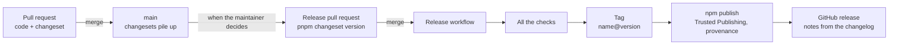

# Releasing

How the packages of qr-bill get from `main` to npm. Contributors only need the first section: they add changesets, and the maintainers publish.

## In short

- Every pull request that changes a published package brings a **changeset**: a short file that says which package changes, how (patch, minor, major) and what users should know. Merging it publishes nothing; changesets pile up on `main`.
- When a maintainer decides to publish, they open a **release pull request**: `pnpm changeset version` turns the pending changesets into new versions and changelog entries.
- Merging the release pull request publishes. The **release workflow** runs on every push to `main` and compares the version of each package with npm: a version that is not on npm yet is tagged, published and released on GitHub. On any other push it finds nothing to do.



The decision to publish is always a human one: the merge of a release pull request. Nothing is published from a computer, and no npm token exists anywhere.

## Vocabulary

| Term               | Meaning here                                                                                                                                                                                                                                                                                                              |
| ------------------ | ------------------------------------------------------------------------------------------------------------------------------------------------------------------------------------------------------------------------------------------------------------------------------------------------------------------------- |
| Version            | The `version` of a package in its `package.json`, following [semantic versioning](https://semver.org); the rules are in [CONTRIBUTING.md](../CONTRIBUTING.md#versions). Each package has its own. A version published on npm can never be published again, even after it is removed: a mistake is fixed by a new version. |
| Changeset          | A Markdown file in `.changeset/`, written by `pnpm changeset`, consumed by `pnpm changeset version`.                                                                                                                                                                                                                      |
| Changelog          | `packages/<name>/CHANGELOG.md`, written by `pnpm changeset version` from the changesets.                                                                                                                                                                                                                                  |
| npm dist-tag       | A label on a version on npm. `latest` is what `npm install @qr-bill/core` installs; prereleases go to `next`.                                                                                                                                                                                                             |
| Git tag            | `@qr-bill/<name>@<version>`, on the commit that was published: the code of a version, forever.                                                                                                                                                                                                                            |
| GitHub release     | The page of a tag on GitHub, with the changelog of the version. The release of `@qr-bill/core` is marked as the latest of the repository.                                                                                                                                                                                 |
| Trusted Publishing | npm accepts a publication only from this repository's release workflow, which proves who it is with a short-lived OpenID Connect token from GitHub. There is no npm token to steal.                                                                                                                                       |
| Provenance         | A signed statement, shown on the npm page, that a version was built by this workflow from this commit. Anyone can check that the package matches the public code.                                                                                                                                                         |

## Changesets, in every pull request

Run `pnpm changeset` when a change affects a published package: its behaviour, its API, its types, or the documentation shipped in it (README, documentation comments). Choose the packages, the kind of version, and write one or two sentences for the users of the package, not for its maintainers. Commit the file with the change. For example `.changeset/brave-owls-sing.md`:

```md
---
'@qr-bill/core': patch
---

`validateTown` accepts a town of exactly 35 characters, as chapter 4.2.2 allows.
```

A change of the tests, the tooling or the documentation of the repository only needs no changeset. **Never change a `version` or a `CHANGELOG.md` in a feature pull request**: only a release pull request does.

`pnpm changeset status` lists the changesets waiting on `main` and the versions they will produce.

## Publishing, step by step

1. **Decide.** On an up-to-date `main`, `pnpm changeset status` shows what is pending. Publish when a fix is waiting, or when enough has piled up; there is no fixed rhythm.
2. **Issue and branch.** Open an issue `chore: release`, then a branch `chore/release-<date or versions>` from `main`.
3. **Version.** Run `pnpm changeset version`. It raises the versions in the `package.json` files (a package that depends on a changed one is raised too when needed), writes the changelogs and deletes the consumed changesets. Read the diff: the versions are the expected ones, and every changelog entry makes sense to a user. The wording of the changelogs may be improved by hand in this pull request.
4. **Check.** `pnpm release:plan` lists the packages to publish. Run the usual checks.
5. **Pull request.** Commit as `chore: release <versions> (#<issue>)`, open the pull request, let the CI pass, merge it ("Squash and merge").
6. **Watch.** In the Actions tab, the "Release" workflow runs on the merge commit. It lists what it will publish, runs every check again, then for each new version: creates the tag, publishes to npm, creates the GitHub release. It takes a few minutes.
7. **Verify.** `npm view @qr-bill/<name> version` shows the new version, the npm page shows the provenance badge, and the tags and releases are on GitHub. A package published for the first time can answer "404 Not Found" for a few minutes: the registry needs that long to show it.

### Prereleases

To let users try a version before it becomes `latest`, enter the prerelease mode on a release branch with `pnpm changeset pre enter next`, then `pnpm changeset version`: the versions look like `0.2.0-next.0`, and the workflow publishes them to the npm tag `next` (`npm install @qr-bill/core@next`). `pnpm changeset pre exit` returns to normal versions.

## What protects a release

| Protection                          | Where                               | What it prevents                                                                                                                    |
| ----------------------------------- | ----------------------------------- | ----------------------------------------------------------------------------------------------------------------------------------- |
| Ruleset "main"                      | GitHub, Settings → Rules            | Any change of `main` other than a pull request with the checks Node 22, 24 and 26 green, merged by squash. Administrators included. |
| Ruleset "release tags"              | GitHub, Settings → Rules            | Moving or deleting a tag `@qr-bill/*`: once a version is tagged, its tag keeps pointing to the code that was published.             |
| Environment `npm`                   | GitHub, Settings → Environments     | Running the publishing job from any branch other than `main`.                                                                       |
| Trusted Publishing                  | npmjs.com, settings of each package | Publishing from anywhere else than the workflow `release.yml` of `qr-bill/qr-bill` in the environment `npm`.                        |
| Checks before publishing            | The workflow                        | Publishing code that does not pass format, lint, types, tests with 100 % coverage, documentation, build and package checks.         |
| Release blockers                    | `scripts/check-release-blockers.js` | Publishing while a README still says that the project is not released.                                                              |
| No publication outside the workflow | `scripts/release.js`                | `pnpm release:publish` refuses to publish on a computer; only `--dry-run` works there.                                              |

## When something goes wrong

- **The workflow failed before publishing anything** (a check, the network): fix the cause in a new pull request if needed, or re-run the workflow from the Actions tab ("Re-run all jobs").
- **It failed in the middle**, for example after publishing one package of two: re-run it. It only does what is missing: a version already on npm is not published again, and a missing GitHub release is created on the existing tag. To retry later from `main`, use "Run workflow" on the "Release" workflow with "dry-run" unticked.
- **A published version is wrong**: never remove it and never move its tag. Publish a fix in a new version. If the wrong version can do harm, deprecate it so that npm warns whoever installs it: `npm deprecate @qr-bill/<name>@<version> "<reason>; use <fixed version>"`.
- **To try the workflow without publishing**: "Run workflow" with "dry-run" ticked (the default) packs every package whose version is not on npm and runs `npm publish --dry-run`. On a computer, `pnpm release:plan` and `pnpm release:publish --dry-run` do the same.

## One-time setup

Done once, recorded here so that it can be checked or redone.

- **npm**: the organisation `qr-bill` owns the scope `@qr-bill`; its members use two-factor authentication for publishing.
- **Trusted Publishing**, for each package on npmjs.com (package → Settings → Trusted Publisher → GitHub Actions): organisation or user `qr-bill`, repository `qr-bill`, workflow filename `release.yml`, environment `npm`. It is set in the settings of an existing package: a new package is published once by hand first, as 0.1.0 was.
- **GitHub environment `npm`**: deployment branches limited to `main`.
- **Rulesets** "main" and "release tags", described above.

History: version 0.1.0 of `@qr-bill/core` and `@qr-bill/pdfkit` was published by hand on 20 November 2026, before this workflow existed, so it carries no provenance. Every later version goes through the workflow.
