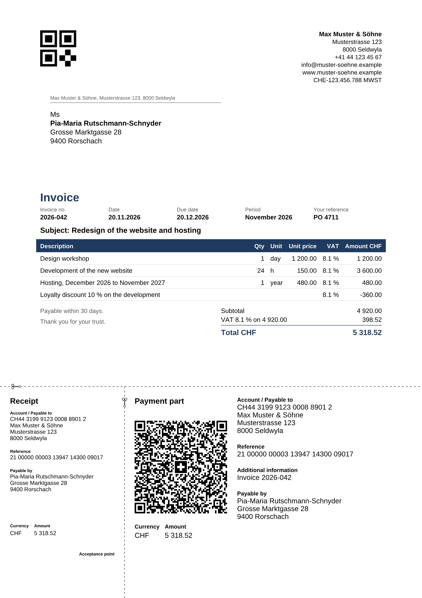

<h1 align="center">
  <picture>
    <source media="(prefers-color-scheme: dark)" srcset="https://raw.githubusercontent.com/qr-bill/qr-bill/main/docs/assets/logo-white.svg" />
    <source media="(prefers-color-scheme: light)" srcset="https://raw.githubusercontent.com/qr-bill/qr-bill/main/docs/assets/logo-black.svg" />
    
  </picture>
</h1>

<p align="center">
  <a href="https://github.com/qr-bill/qr-bill/actions/workflows/ci.yml"></a>
  <a href="https://www.npmjs.com/package/@qr-bill/invoice"></a>
  <a href="https://github.com/qr-bill/qr-bill/blob/main/vitest.config.ts"></a>
  <a href="https://github.com/qr-bill/qr-bill/blob/main/LICENSE"></a>
</p>

A Swiss invoice on A4 with its QR-bill, from your data: your logo and details, the recipient in the window of the envelope, the lines, the VAT and the totals, a few ready-made mentions, and the payment part at the bottom of the last page. In German, French, Italian, Romansh and English. Built on [`@qr-bill/core`](https://github.com/qr-bill/qr-bill/tree/main/packages/core).

<p align="center">
  <a href="https://github.com/qr-bill/qr-bill/blob/main/docs/assets/invoice-business.pdf"></a>
</p>

- **One call.** `createInvoicePDF(data)` returns the PDF: letterhead with your logo, the recipient in the window of the envelope, the details, the lines over as many pages as needed, the VAT and the totals, ready-made mentions, and the payment slip at the bottom of the last page.
- **Always produced, never overflowing.** Only the form of the data is checked; every field has a documented maximum length, and every text stays in its zone. The QR-bill of the payment part is checked by `@qr-bill/core`, since a wrong one would make the payment go astray.
- **Exact amounts.** Computed in integers from decimal strings: VAT per rate, prices with or without VAT, rounding to 5 centimes; or totals computed elsewhere, printed as given.
- **Five languages, three themes.** German, French, Italian, Romansh and English; `standard`, `business` and `modern`, with your accent colour, every text kept readable.
- **Light.** A page with its payment slip weighs about 42 KB: the fonts are embedded with only the characters used.

## Install

```sh
npm install @qr-bill/invoice pdfkit
```

Node 22.12 or later, PDFKit 0.17 or later.

## Example

```ts
import { writeFile } from 'node:fs/promises';
import { createInvoicePDF } from '@qr-bill/invoice';

const pdf = await createInvoicePDF({
  language: 'en',
  theme: 'business',
  number: '2026-042',
  date: '2026-11-20',
  dueDate: '2026-12-20',
  issuer: {
    name: 'Max Muster & Söhne',
    street: 'Musterstrasse',
    buildingNumber: '123',
    postalCode: '8000',
    town: 'Seldwyla',
    country: 'CH',
    uid: 'CHE-123.456.788',
    vatRegistered: true,
  },
  recipient: {
    name: 'Pia-Maria Rutschmann-Schnyder',
    street: 'Grosse Marktgasse',
    buildingNumber: '28',
    postalCode: '9400',
    town: 'Rorschach',
    country: 'CH',
  },
  items: [{ description: 'Development of the new website', quantity: 24, unit: 'h', unitPrice: '150', vatRate: '8.1' }],
  mentions: { paymentDays: 30, thanks: true },
  payment: { account: 'CH44 3199 9123 0008 8901 2', reference: '210000000003139471430009017' },
});
await writeFile('invoice.pdf', pdf);
```

Invalid data throws an `InvoiceValidationError` listing every problem; `validateInvoice` returns them without throwing, for a form.

## Documentation

The complete documentation is in [docs/invoice.md](https://github.com/qr-bill/qr-bill/blob/main/docs/invoice.md):

- [the page](https://github.com/qr-bill/qr-bill/blob/main/docs/invoice.md#the-page) and [the logo](https://github.com/qr-bill/qr-bill/blob/main/docs/invoice.md#the-logo);
- [the schema](https://github.com/qr-bill/qr-bill/blob/main/docs/invoice.md#schema), with the limit of every field;
- [the themes](https://github.com/qr-bill/qr-bill/blob/main/docs/invoice.md#themes), [the amounts](https://github.com/qr-bill/qr-bill/blob/main/docs/invoice.md#amounts) and [the payment part](https://github.com/qr-bill/qr-bill/blob/main/docs/invoice.md#the-payment-part);
- [what Swiss law asks of an invoice](https://github.com/qr-bill/qr-bill/blob/main/docs/invoice.md#what-swiss-law-asks-of-an-invoice);
- [the problems](https://github.com/qr-bill/qr-bill/blob/main/docs/invoice.md#problems) and their codes.

## License

MIT © Olivier Azevedo — maintained by [Claine](https://claine.ai).
